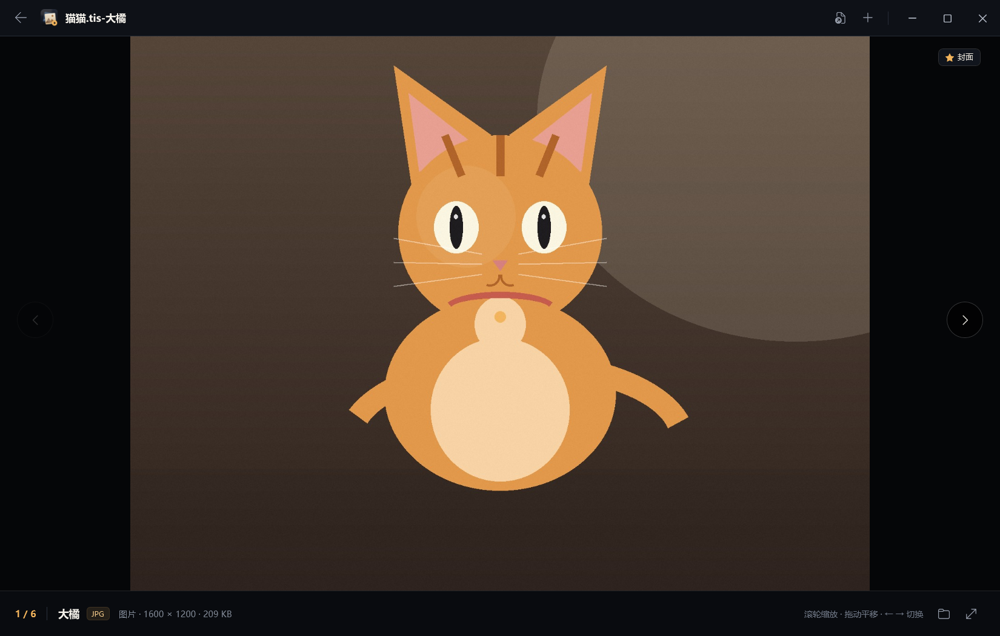
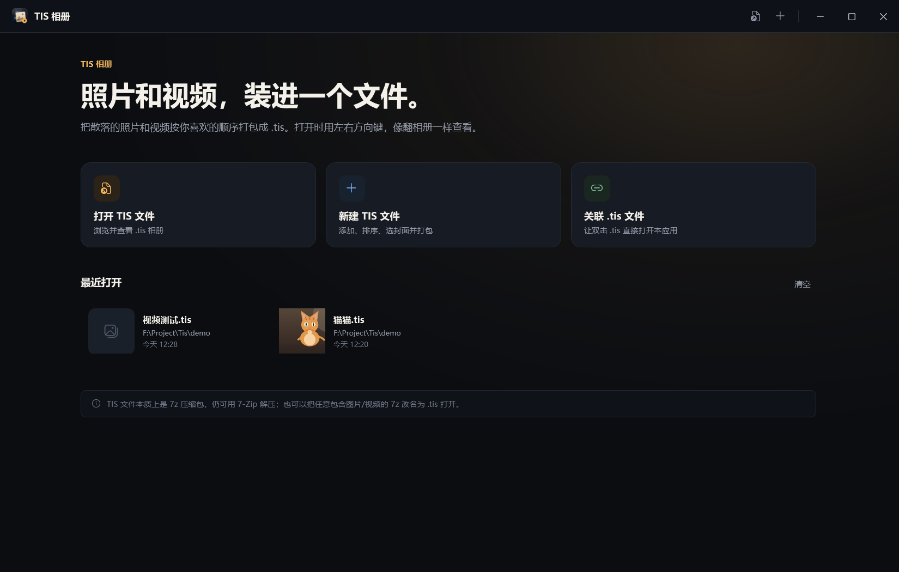
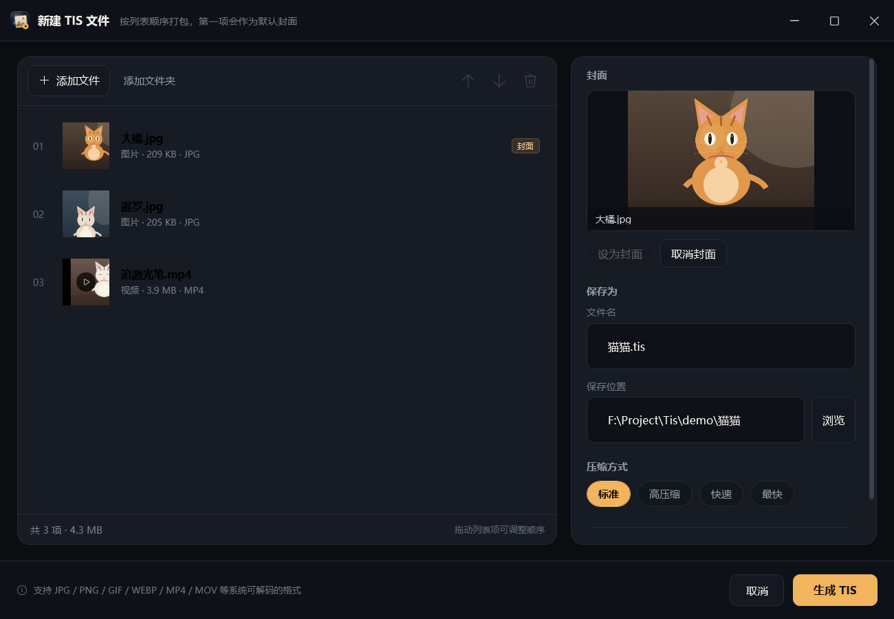

# TIS 相册 · TisViewer

一个用 C# / WPF 编写的 Windows 桌面应用，用来**查看**和**生成** `.tis` 相册文件。

`.tis` 本质上是一个 **7z 压缩包**，里面按顺序存放照片和视频。TisViewer 会把压缩包里的媒体按内部顺序展示，并用 `文件名-原始文件名` 作为标题，例如打开 `cat.tis` 时标题栏显示 `cat.tis-大橘`、`cat.tis-暹罗`。



## 功能

- 打开任意位置的 `.tis`（文件对话框、拖放、命令行参数、文件关联双击）
- 图片与视频混排，按压缩包内部顺序用 `←` / `→` 逐项查看
- 标题栏显示 `TIS文件名-媒体原始名称`，底部显示序号、类型、尺寸/时长、大小
- 图片支持滚轮缩放、拖动平移、双击复位；视频支持播放/暂停、进度拖动、静音、全屏
- 封面：生成时可选任意一项作为封面，打开时首先显示封面，并带有「封面」标记
- 生成器：添加文件/文件夹、拖拽排序、上下移动、移除、设置封面、选择压缩级别、实时进度
- 自动记住最近打开的文件（带封面缩略图）
- 单实例：已经打开窗口时，再双击另一个 `.tis` 会复用当前窗口
- 内置 `.tis` 文件关联按钮（写入当前用户注册表，无需管理员）
- 生成 `.tis` 时同时写入 `__tis__/manifest.json`，记录顺序、封面和原始名称；用 7-Zip 打开也仍然是一个普通 7z

| 首页 | 生成器 |
| --- | --- |
|  |  |

## 直接运行

发布版是一个单文件程序：

```
dist\TisViewer.exe
```

运行要求：

- Windows 10 1809 或更高版本（Windows 11 亦可），x64
- [.NET 8 Desktop Runtime](https://dotnet.microsoft.com/download/dotnet/8.0)（不是 ASP.NET Runtime）
- 单文件已包含 TisViewer 与 SharpCompress，直接双击即可；不需要安装本程序

> 从 zip 使用时请先完整解压到固定目录再运行；文件关联记录的是 exe 的绝对路径，移动目录后需要重新关联。

第一次使用可以打开示例相册 `demo\猫猫.tis`，或用示例素材重新生成一个。

## 使用说明

### 查看

1. 启动 `TisViewer.exe`，点击「打开 TIS 文件」；或把 `.tis` 拖进窗口；或直接双击已关联的 `.tis`。
2. 用 `←` / `→` 切换上一项/下一项，标题栏会实时显示 `文件名-原始文件名`。
3. 视频会自动播放，`空格` 暂停/继续；底部滑块可拖动进度。
4. 图片上滚轮缩放，按住左键拖动，双击在 100% 和 220% 之间切换。
5. `F` 或 `F11` 进入/退出全屏，`Esc` 退出全屏。

### 生成

1. 在首页点击「新建 TIS 文件」。
2. 点击「添加文件」「添加文件夹」，或直接把照片/视频拖进列表。
3. 用鼠标拖动列表项调整顺序，也可以使用工具栏的上移/下移/移除。
4. 选中某一项后点击「设为封面」；不设置时默认使用第一项。
5. 选择保存位置、文件名和压缩方式，点击「生成 TIS」。
6. 生成完成后可直接「打开查看」。

列表顺序就是浏览顺序；封面只决定打开时首先显示哪一项。

### 关联 `.tis` 文件

在首页点击「关联 .tis 文件」。程序会写入当前用户的：

```
HKCU\Software\Classes\.tis
HKCU\Software\Classes\TisViewer.TisFile
HKCU\Software\Classes\Applications\TisViewer.exe
```

再次点击可取消关联。如果 Windows 11 仍然用别的程序打开，可以右键 `.tis` →「打开方式」→「选择其他应用」→ 选择 TisViewer 并勾选「始终使用」。

移动了程序目录后需要重新点一次关联。也支持命令行：

```powershell
TisViewer.exe --register
TisViewer.exe --unregister
```

## 快捷键

| 按键 | 作用 |
| --- | --- |
| `←` / `→` | 上一项 / 下一项 |
| `Home` / `End` | 第一项 / 最后一项 |
| `空格` | 视频播放/暂停；图片下一项 |
| `Ctrl + ←` / `Ctrl + →` | 视频后退/快进 5 秒 |
| `F` / `F11` | 进入/退出全屏 |
| `Esc` | 退出全屏 |
| `M` | 静音切换 |
| `↑` / `↓` | 音量 ±5% |
| `Ctrl + O` | 打开 `.tis` |
| `Ctrl + N` | 新建 `.tis` |

## `.tis` 格式

- 容器：标准 7z 压缩包（LZMA2）
- 媒体文件位于压缩包根目录，保留原始文件名
- 元数据：`__tis__/manifest.json`（由 TisViewer 生成）
- 没有清单的普通 7z 改名为 `.tis` 也能打开：按压缩包条目顺序展示，标题使用“文件名去掉扩展名”

清单示例：

```json
{
  "format": "tis",
  "version": 1,
  "title": "cat",
  "cover": "大橘.jpg",
  "created": "2026-10-23T12:00:00+08:00",
  "items": [
    { "entry": "大橘.jpg", "name": "大橘", "kind": "image", "size": 213984 },
    { "entry": "暹罗.jpg", "name": "暹罗", "kind": "image", "size": 209614 },
    { "entry": "追激光笔.mp4", "name": "追激光笔", "kind": "video", "size": 4121560 }
  ]
}
```

- `cover` 对应 `items` 中的 `entry`，打开时首先定位到该项
- `name` 是压缩前的原始名称（不含扩展名），标题和列表都使用它
- 同名文件会自动生成 `大橘 (2).jpg` 这样的条目，`name` 也会相应去重

压缩方式说明：

| 选项 | 实现 |
| --- | --- |
| 标准 | LZMA2，压缩级别 5（推荐） |
| 高压缩 | LZMA2，级别 9，文件更小、更慢 |
| 快速 | LZMA2，级别 2 |
| 最快 | LZMA2，级别 0 |

## 从源码构建

需要 .NET SDK 8 或更高版本（本项目以 `net8.0-windows` 为目标框架）。

```powershell
dotnet restore
dotnet build -c Release
dotnet publish TisViewer.csproj -c Release -r win-x64 --self-contained false `
  -p:PublishSingleFile=true -p:EnableSingleFileAnalyzer=false `
  -p:DebugType=none -p:IncludeNativeLibrariesForSelfExtract=true -o dist
```

上面的命令生成单文件 `dist\TisViewer.exe`。如果不需要单文件，也可以去掉 `-r` 与 `PublishSingleFile` 参数，生成普通的多文件输出。

依赖还原优先使用仓库内的本地源：

- `packages/SharpCompress.0.50.4.nupkg`
- `nuget.config` 同时配置了仓库内 `packages/` 与 nuget.org，离线环境也能还原

如果你的环境可以访问 nuget.org，也可以删除本地包，直接使用官方源。

## 项目结构

```
TisViewer.csproj         WPF 应用（net8.0-windows）
App.xaml / App.xaml.cs   启动、单实例、全局异常
MainWindow               首页 + 查看器
CreateWindow             生成器
Models/                  TIS 清单、媒体项、格式判断
Services/                7z 读写、缓存、文件关联、最近文件、单实例、路径
Helpers/                 图片解码（含 EXIF 方向）
Themes/Styles.xaml       暗色主题、按钮、输入框、滑块、滚动条
Assets/                  应用图标
docs/                    README 截图
demo/                    示例素材与示例 TIS
dist/                    单文件发布输出
```

## 数据与缓存

默认写入：

```
%LOCALAPPDATA%\TisViewer\
  recent.json      最近打开列表
  error.log        未处理异常日志
  Cache\           视频播放前解压出的临时文件
```

视频第一次播放会先解压到缓存（界面显示进度），之后复用；缓存目录超过 14 天会在启动时清理。

需要绿色/便携运行时，可设置环境变量：

```powershell
$env:TIS_DATA_DIR = "D:\PortableTisData"
```

## 已知限制

- 视频播放使用 WPF `MediaElement`（系统 Media Foundation 解码器）。H.264/AAC 的 MP4、WMV 通常可直接播放；HEVC、部分 MKV/AVI 可能缺少解码器。失败时会显示提示，并提供「用默认应用打开」。
- HEIC / HEIF / AVIF / WebP 等图片格式依赖系统已安装的解码器；GIF 只显示第一帧。
- 不支持加密/带密码的 7z。
- 文件关联按当前用户注册；Windows 11 有时仍会要求用户确认默认应用。
- 生成时同名文件会自动重命名，不会覆盖压缩包内的其他条目。
- 本项目不修改 `.tis` 文件的资源管理器缩略图；封面只在 TisViewer 内生效。
- 程序未做代码签名，首次运行可能触发 Windows SmartScreen；可选择「更多信息」→「仍要运行」。

## 第三方

- [SharpCompress](https://github.com/adamhathcock/sharpcompress) 0.50.4，MIT License，用于 7z 读写。
- 7z 格式由 Igor Pavlov 设计；`.tis` 只是带清单的 7z，可用 7-Zip 直接解压。

## 开源协议

本项目使用 [MIT License](LICENSE)。

欢迎提交 Issue 和 Pull Request。提交前请先运行一次 `dotnet build -c Release`，并尽量保持现有的代码风格与中文界面文案。

## 致谢

示例相册里的图片与视频是为本项目生成的演示素材；界面使用 WPF 原生控件绘制，没有引入额外 UI 框架。

